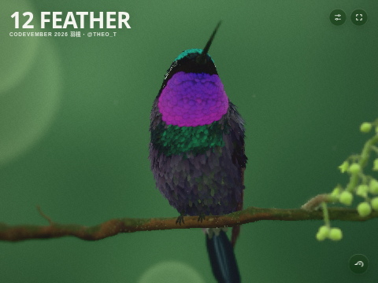
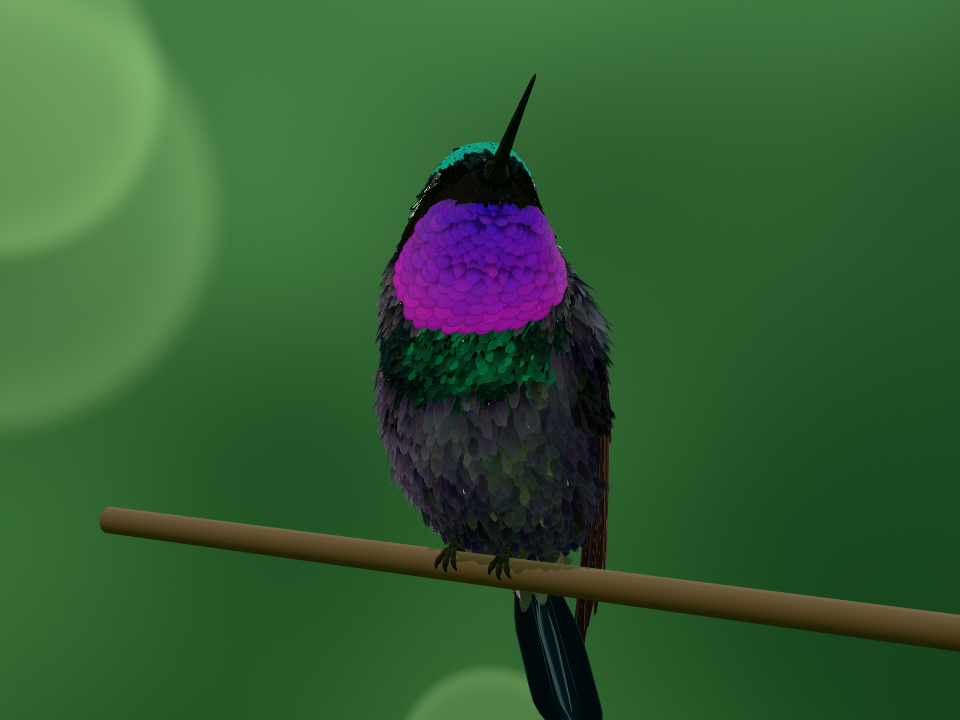
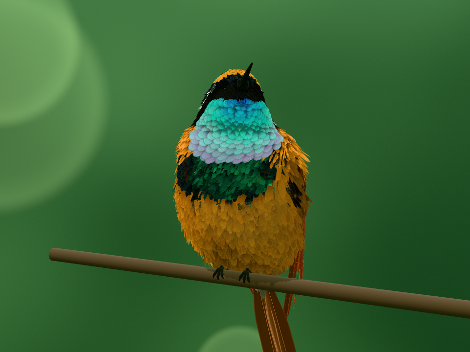

# Feather 拆分记录

来源：Theo Tillberg，MIT；基线提交 `f7618b3`，fork `heyzhangh/codevember-2026`。
产出位于 `codex-bird`，只新增 `bird/`、`bird-evidence/` 和本说明。
`12/`、其他实验、原站构建配置及 `main` 均保持不变。没有部署或修改 mrhao.cc。

## 运行与截图

独立项目可以整目录复制出去，Node 22.12+，无需原仓库工作区：

```sh
cd bird
npm ci
npm run dev
npm run build       # 类型检查 + Vite，纯静态文件输出到 bird/dist/
npm run preview
```

默认使用原物种；`?species=proof` 切换验证数据。
页面只有 canvas、鸟、简单栖木和森林背景，没有导航、标题牌、设置或录制工具。
`dist/` 采用相对资源路径，已通过 `/bird-preview/` 子路径的静态 HTTP 测试。
在 `/tmp/codex-bird-isolated` 单独复制源码后执行 `npm ci && npm run build`，
确认不借用父仓库依赖；5 个构建文件与工作区构建逐字节一致。

原版运行：仓库根目录 `pnpm install --frozen-lockfile`，再 `pnpm -C 12 dev --port 5173`。
原版类型检查和 `pnpm -C 12 build` 已通过，完整 GLB、场景与后处理的截图如下。



原版截图使用 `?still&quiet&pose=three` 以固定镜头与头部姿态，保留原版树枝模型和后处理。
云端为 SwiftShader，截图采用 960×720 CSS 像素、DPR 0.5（PNG 为 480×360）。
**原版存在首帧负 dt 问题**：同步生成几何体耗时后，排队的 RAF 时间戳可能早于
`new THREE.Timer()`，原页只限制 dt 上限，导致姿态越界、鸟被拉到画面外。
[异常截图](bird-evidence/00-original-startup-clock.png)保留了这个实际失败结果。
成功截图由 [capture-original.mjs](bird-evidence/capture-original.mjs) 在浏览器测试层
把 RAF 回调时间戳换成当下 `performance.now()`；**没有修改 `12/` 源码**。
这是明确的原版运行兼容处理，不能据此声称原版启动毫无问题。
独立宿主改用回调内 `timer.update()`，并将 dt 限制为 `[0, 1/20]`，已验证无负时间。

| 独立版原物种 | 仅换物种数据 |
| --- | --- |
|  |  |

## 提取边界与依赖

- `12/src/bird/*` → `bird/src/engine/*`：完整保留身体截面 loft、骨骼、裸露部件、
  羽毛几何与材质、姿态求解器、物种/配色数据，以及 `motion/` 下全部 14 个行为模块
  （含共享 Mind）。原鸟生成、绑定与行为算法不变。全部 26 个核心文件的路径与
  SHA-256 清单见 `bird-evidence/metrics.json` 的 `engineHashes`。
- 核心原本真正依赖的是 `three` 和目录内的 `util.ts`、`types.ts` 等模块；
  没有依赖仓库级模板或共享元数据模块。`palettes.ts` 是原页面使用的可选配色工具，也保留。
- 核心 `index.ts` 的 URL 开关、`window.__bird` 与骨骼调试显示移至
  `bird/src/demo/debug.ts`；核心现在可由调用方直接创建、更新和释放多个实例。
- `plumageGeometry.ts` 只增加计数：每次 `Builder.add()` 加一，写入
  `geometry.userData.featherCount`。未改生成公式。绒毛壳层单独统计，不冒充独立羽毛。
- `12/src/env/backdrop.ts` → `bird/src/demo/backdrop.ts`，只改 util 导入路径。
  这是演示场景的可选依赖：提供森林背景和羽毛所需环境光照，不属于鸟核心。
- 新 `scene.ts` 负责 Three.js renderer、OrbitControls、灯光、环境贴图、
  简单圆柱栖木、尺寸与输入、帧循环及清理；不再引入原来的 `env/branch.ts`、
  `env/sway.ts`、6,242,068 字节 `branch.glb`、后处理 `post.ts`、seeds/insects/ambient、
  actions/settings/device、原 HTML/CSS、Google Fonts、站点模板/元数据和录制构建脚本。
  **去掉后处理会改变景深、颗粒、调色；栖木也简化了。鸟的几何、羽毛材质与行为保留。**
- `bird/package.json` 和 `package-lock.json` 自成项目，生产依赖只有 `three@0.187.0`。
  Vite、TypeScript、类型声明和 Playwright 仅用于开发/验证，不进入生产依赖链。
  `LICENSE`、作者署名与来源保留，静态构建也携带 `LICENSE`、`NOTICE.txt`。

复用核心：`import { createBird } from './bird/src/engine'`，调用
`createBird({ species })`，把 `root` 放入场景，每帧 `update(dt)`，移除时 `dispose()`。
完整使用示例见 [bird/README.md](bird/README.md)。

## 数据替换验证

验证数据仅在 `bird/src/species/proof.ts`，通过 `createBird({ species })` 注入。
不是改材质统一染色，也没有给引擎加验证物种分支；两个页面请求同一个 JS bundle。
原 `MOUNTAIN_GEM` 对象未被改写，验证版也不是最终自创物种。

| 字段 | 原数据 → 验证数据 |
| --- | --- |
| `sections[0..5].w / rd / rv` | 分别 ×1.18 / ×1.08 / ×1.12，身体变宽厚 |
| `bill.length` | 0.44 → 0.23，明显短喙 |
| `looks` 中身体羽区 `base/tip/iri/iriGraze` | 暗紫灰 → 琥珀橙 |
| `looks.gorget` 与 `looks.crown` 羽色 | 紫喉/青冠 → 青绿喉/金冠 |
| `shading.gold/goldAmount` | 配合新的暖色羽毛 |
| `wing.shoulder/color/sheen` | 肩宽配合体型；翼羽改棕金色 |
| `tail.length/color` | `[0.61,0.66]` → `[0.82,0.9]`，尾羽变长、变暖 |
| `behaviour.breathHz/holdCalm/blinkEvery` | 更慢呼吸、更长凝视/眨眼间隔 |

## 性能与验证

原始数据和完整测量方法见 [metrics.json](bird-evidence/metrics.json)。
羽毛数为实际几何生成调用计数；截图和性能测试不减羽、不隐藏羽区。

| 项目 | 原物种 | 验证物种 |
| --- | ---: | ---: |
| 轮廓羽毛 | 10,621 | 11,306 |
| flight 缓冲中的羽毛（含翼/尾及附属羽） | 388 | 388 |
| 总羽毛数 | 11,009 | 11,694 |
| 羽毛三角形，不含绒毛壳 | 152,348 | 161,780 |
| 额外绒毛壳三角形 | 57,600 | 57,600 |
| 骨骼数 | 84 | 84 |
| 鸟的几何属性/索引缓冲合计 | 25,197,510 B | 26,334,186 B |
| 每帧 draw calls（含阴影） | 18 | 18 |
| 本机软件渲染观测 FPS | 0.174 | 0.225 |
| FPS 样本 | 10 帧 / 57.581 秒 | 10 帧 / 44.532 秒 |

测量环境：Linux、Chromium 156.0.8078.79、SwiftShader Vulkan 软件渲染，
容器配额 2 vCPU / 8 GiB；960×720、DPR 1、固定头部姿态，保留呼吸与全部羽毛、绒毛和阴影。
FPS 取编译后至少 8 秒且至少 10 个真实 RAF 间隔，不使用虚拟时钟，不含截图和行为快进。
这是软件渲染观测，**不是桌面 GPU 或手机性能验收**；进入真实首页前仍须实机测试。
FPS 很低，且样本少、波动大，不能据此比较两套物种谁更快；原始间隔与分位数见
`metrics.json`。几何缓冲数字不等于浏览器总内存或显存。
原版 README 写 79 根骨骼，当前提交运行时实际是 84 根。

| 静态构建体积（十进制 KB，gzip level 6） | 原版第 12 天 | 独立版 |
| --- | ---: | ---: |
| 主 JS | 843.09 KB | 680.94 KB |
| 主 JS gzip | 235.55 KB | 183.83 KB |
| 全部发布文件未压缩合计 | 7,103,337 B | 682,980 B |
| 独立版所有文件分别 gzip 后合计 | — | 185,174 B |

独立版合计包含 HTML、CSS、JS、LICENSE 和 NOTICE，不含源码、开发依赖及证据截图。
两套物种在同一个演示 bundle 内。Vite 的 >500 KB 警告仍存在，没有通过调高阈值隐藏；
Three.js 与完整羽毛 shader 仍是主要负担，本次未做 LOD、减羽或主页性能验收。

`npm run verify` 会直接服务 `dist/`，测试两套数据使用同一 bundle、画面有大量真实
三角形且头部位于镜头内、无运行/着色器错误、无外部请求；另推进 15 秒行为系统，
验证眼跳、眨眼、呼吸和骨骼数值，再验证重复销毁安全、动画停止和几何资源归零。
行为快进与截图操作均不计入 FPS。运行示例：

```sh
cd bird
BIRD_SOFTWARE_GL=1 npm run verify
# 可用 CHROMIUM_PATH 指定已安装的 Chromium；不会下载浏览器或连接账号。
```

另已在没有 `window/document` 的 Node 环境创建两个核心实例，销毁其一后让另一只
继续更新 10 秒，确认骨骼数值有限、实例隔离且原物种对象未被修改。

## 仍有的耦合与后续边界

没有阻碍独立提取的整站硬耦合。但“只换数据”有范围：`plumageGeometry.ts` 按
`body/flank/head/stripe/gorget/crown/covert/wingCovert` 等约定键取羽区，局部美术规则
仍有 `6.0/6.7/8.5` 等截面坐标常数；rig/solver 也预设鸟类身体、双翼、尾扇和命名骨骼。
本次证明同一拓扑下换体型、颜色、羽区和节奏；**没有证明任意骨骼拓扑、截面布局或
极端形态都能只换数据**。未来大幅改型需要先把这些隐含约定参数化。

羽毛已经合并进少量 SkinnedMesh，不是 11,009 个独立 Object3D；目前没有逐羽生长进度
或稳定的逐羽 ID。调试骨架只是骨骼线，不是解剖标本模型。三幕叙事、滚动控制、
逐根长羽、工具入口点亮和最终物种设计都没有实现；本次保留的核心 API 可供下一阶段接入。
